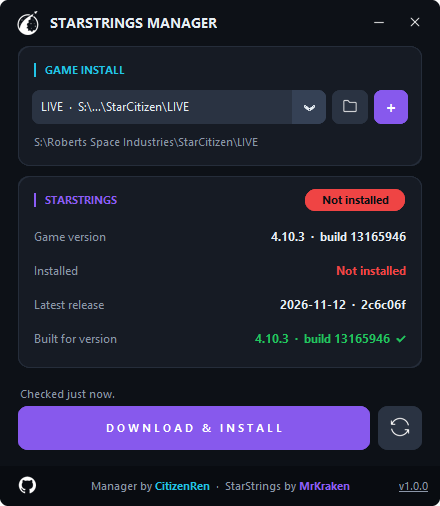

# StarStrings Manager

A small Windows app that installs and keeps [MrKraken's StarStrings](https://github.com/MrKraken/StarStrings) up to date for Star Citizen.

StarStrings is a community-made `global.ini` that adds useful information to in-game text: blueprint rewards on contracts, component sizes and grades, mining info and more. It has to be updated after every game patch, and StarStrings Manager takes care of that for you.

<p align="center"></p>

## Features

- **Finds your game automatically.** It reads the RSI Launcher's logs and checks the usual install folders on every drive. You can also add any folder yourself (LIVE, PTU, EPTU and so on) with the **+** button.
- **Shows versions side by side.** You see your game's patch version, the installed StarStrings, the latest StarStrings release, and the game build that release was made for. A ✓ means StarStrings matches your game build.
- **One-click install and update.** It downloads the latest LIVE release from GitHub and installs it the way the StarStrings readme describes.
- **Backs up before updating.** It asks whether you want a copy of your current files saved first.
- **Checks for updates** when it starts and whenever you press the refresh button. It also tells you when a new version of StarStrings Manager itself is out.
- **Uninstalls cleanly.** It removes only what it added.
- **Single exe, nothing to install.** Settings are kept in `%APPDATA%\StarStrings Manager`.

## Download

Get `StarStrings Manager.exe` from the [Releases](https://github.com/CitizenRen/StarStrings-Manager/releases) page and run it.

## What it changes in your game folder

Inside the selected game folder (for example `...\StarCitizen\LIVE`):

| Path | What happens |
|---|---|
| `data\Localization\english\global.ini` | The StarStrings file is added or replaced. |
| `data\Localization\english\.starstrings_manager.json` | A small marker recording which release is installed. |
| `user.cfg` | `g_language = english` is added or set. Your other settings are kept, and the file is created if it doesn't exist. |
| `StarStrings_Backups\<date-time>\` | Backups, only if you choose to make one. |

**Remove** (the bin button) deletes `global.ini` and the marker, and takes the `g_language` line out of `user.cfg`.

> If Windows blocks writing to the game folder, close Star Citizen, or run StarStrings Manager as administrator.

## Building from source

You need Python 3.12 or newer on Windows.

```bash
src\build.bat
```

The script installs the build dependencies from `src/requirements.txt`, then generates the icons from `assets/` into `assets/generated/`, and finally packages everything with PyInstaller into `builds\StarStrings Manager.exe`.

To run it without building, generate the icons once and start the app:

```bash
pip install -r src/requirements.txt
python src/make_icons.py
python src/app.py
```

### Project layout

```
assets/
  app-icon.png        exe icon (source)
  window-icon.png     window / taskbar icon and title-bar logo (source)
  github-mark.svg     footer GitHub button
  ui-icons/*.svg      button icons (GitHub Octicons)
  generated/          created by make_icons.py, not committed
src/
  app.py              the window and UI
  core.py             game detection, version checks, download/install/backup/remove
  make_icons.py       turns the source art into .ico/.png files
  build.bat           one-step build into builds/
  requirements.txt    build dependencies
```

### Releasing a new version

1. Raise `APP_VERSION` in `src/core.py`.
2. Run `src\build.bat`.
3. Create a GitHub release tagged `vX.Y.Z` (it must be higher than the previous one) and attach the exe.

Older copies of the app will then show the update in their footer.

## Credits

- **StarStrings Manager** by [CitizenRen](https://github.com/CitizenRen)
- **StarStrings** by [MrKraken](https://github.com/MrKraken): all the string work is theirs. Please report string problems on the [StarStrings issues page](https://github.com/MrKraken/StarStrings/issues).
- Icons from [GitHub Octicons](https://github.com/primer/octicons) (MIT).

## Disclaimer

This is an unofficial Star Citizen fan project. It is not affiliated with or endorsed by the Cloud Imperium group of companies. StarStrings is a third-party community file; use it at your own discretion. CIG may ask for community localisation files to stop being distributed at any time.
